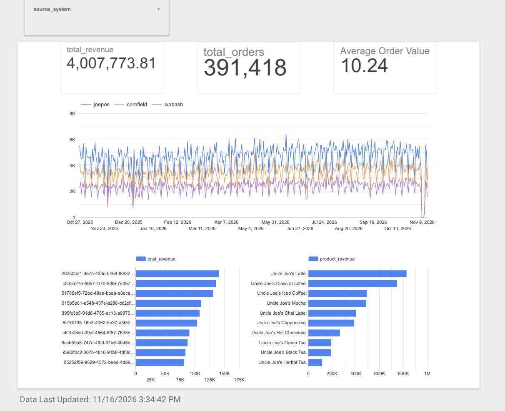

---
title: "Cloud-Based POS Data Pipeline"
excerpt: "Integrated and cleaned data from three POS systems using Google Cloud, BigQuery, and SQL."
collection: portfolio
permalink: /portfolio/cloud-pos-data-pipeline/
---

# Cloud-Based POS Data Pipeline

*Looker Studio dashboard developed for a Purdue academic project using simulated POS data.*

**Project Type:** Academic Project | Purdue University  
**Tools:** Google Cloud Platform, BigQuery, SQL, Cloud Run, Looker Studio

## Project Overview

In this project, I worked on building a cloud-based data pipeline for a fictional restaurant business called Uncle Joe's.

The business had three different point-of-sale (POS) systems: JoePOS, Wabash, and Cornfield. Each system stored its data in different formats, making it difficult to combine information and generate consistent business reports.

The goal was to create a reliable process to clean, standardize, and integrate data from these three sources.

## Business Problem

The three POS systems had several data consistency issues:

- Different date formats across systems
- Currency values stored with different symbols and text
- Inconsistent product names and size labels
- Separate datasets that made reporting difficult

Without standardized data, it was harder to compare business performance across locations and POS systems.

## What I Did

### 1. Data Cleaning with SQL

I used BigQuery SQL to transform raw order and order-item data into consistent formats.

My cleaning process included:

- Standardizing date and timestamp formats
- Removing currency symbols before converting prices to numeric values
- Normalizing product names and size categories
- Converting fields into appropriate data types

### 2. Data Integration

I created standardized BigQuery tables for orders and order items.

These tables allowed data from the three POS systems to follow a common structure, making analysis and reporting easier.

### 3. Automated Data Processing

I configured scheduled data processing and worked with a Cloud Run-based workflow to refresh cleaned tables when new data arrived.

This reduced the need for manually repeating the same cleaning steps.

### 4. Business Reporting

I connected the processed data to Looker Studio to explore reporting across the different POS systems.

This helped demonstrate how standardized data can support business analysis.

## Results

- Created standardized order and order-item tables in BigQuery
- Integrated data from three POS systems into a consistent structure
- Implemented repeatable SQL-based cleaning transformations
- Tested automated refresh workflows
- Built a Looker Studio reporting view for comparing data sources

## What I Learned

This project helped me understand how raw business data becomes useful for decision-making.

I learned that data cleaning is not just a technical task. If different systems use inconsistent formats, even simple business reports can become unreliable.

I also gained practical experience with cloud data processing, SQL transformations, and workflow automation.

## Data Privacy

This portfolio describes the technical approach and project outcomes without publishing raw datasets, customer records, or restricted course materials.
